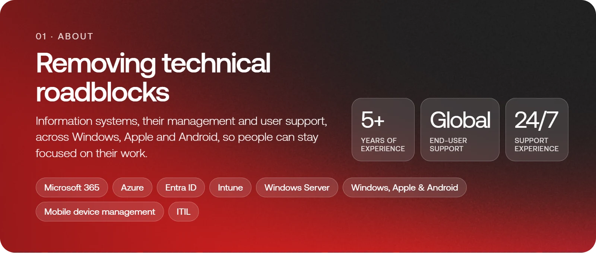
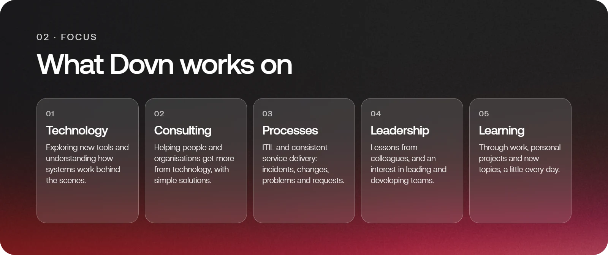

  <a href="https://dovn.com"><b>dovn.com</b></a> ·
  <a href="https://dovn.com/about">About</a> ·
  <a href="https://dovn.com/projects">Projects</a> ·
  <a href="https://dovn.com/blog">Blog</a> ·
  <a href="https://dovn.com/contact">Contact</a>

  <a href="https://status.dovn.com">Status</a> ·
  <a href="https://learn.dovn.com">Learn</a> ·
  <a href="https://survey.dovn.com">Survey</a> ·
  <a href="https://domains.dovn.com">Domains</a>

<b>Got a roadblock? Let's clear it.</b> <a href="https://dovn.com/contact">Get in touch</a>

