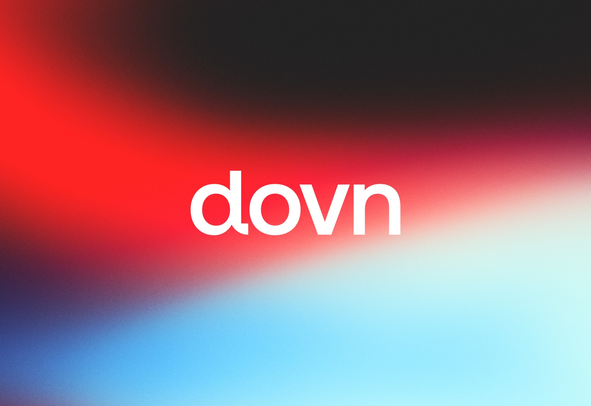

  <a href="https://dovn.com">dovn.com</a> •
  <a href="https://dovn.com/about">About</a> •
  <a href="https://dovn.com/projects">Projects</a> •
  <a href="https://dovn.com/blog">Blog</a> •
  <a href="https://dovn.com/contact">Contact</a>

## Removing technical roadblocks

An IT professional focused on removing technical roadblocks and helping people stay
productive: information systems, their management and user support, across Windows, Apple
and Android. On the side: Roblox worlds like Super Sports!, logos, websites and small tools.

| 5+ | Global | 24/7 |
| :-- | :-- | :-- |
| Years of experience | End-user support | Support experience |

`Microsoft 365` `Azure` `Entra ID` `Intune` `Windows Server` `Windows, Apple & Android`
`Mobile device management` `ITIL`

## What Dovn works on

- **Technology**: exploring new tools and understanding how systems work behind the scenes.
- **Consulting**: helping people and organisations get more from technology, with simple solutions that make work easier.
- **Processes**: ITIL, operational excellence and consistent service delivery: incidents, changes, problems and requests.
- **Leadership**: lessons from colleagues, and an interest in leading and developing teams.
- **Learning**: learning through work, personal projects and new topics, a little every day.

## Find Dovn

| Site | What it is |
| :-- | :-- |
| [dovn.com](https://dovn.com) | Projects, the blog and how to get in touch |
| [status.dovn.com](https://status.dovn.com) | Live service status |
| [learn.dovn.com](https://learn.dovn.com) | Lessons and guides |
| [survey.dovn.com](https://survey.dovn.com) | Surveys and forms |
| [domains.dovn.com](https://domains.dovn.com) | Names for sale |

**Got a roadblock? Let's clear it.** [Get in touch](https://dovn.com/contact).
